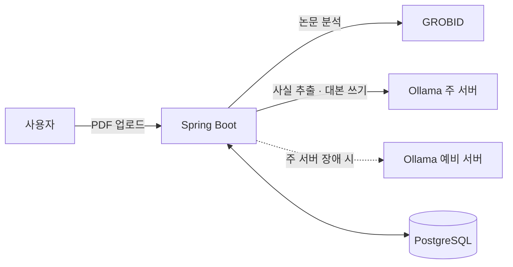

# read_manga

[](https://github.com/yuJunhyk/paper_manga/actions/workflows/test.yml)
  

**연구 논문 PDF를 올리면, 컷마다 원문 근거가 붙은 한국어 학습 만화 대본(4쪽)을 만들어 주는 Spring 백엔드입니다.**

논문은 읽기 어렵고, AI 요약은 논문에 없는 내용을 지어낼 수 있습니다. 그래서 이 서비스는 컷마다 "이 내용이 논문 몇 쪽 몇 번 문장에서 나왔는지"를 함께 저장해, 사용자가 버튼 하나로 원문을 확인할 수 있게 합니다. 완성된 대본은 근거 원문을 접어 둔 Markdown 파일로도 받을 수 있습니다.

| 논문 1편 처리 | 결과 | 테스트 | 만화 조회 DB 질의 |
| --- | --- | --- | --- |
| 약 6분 (Latent Diffusion 논문, 업로드 → 완료) | 4쪽 21컷 (사실 19 · 연출 2) | 150개 (push마다 CI) | 71번 → 6번 |

**결과 예시** (High-Resolution Image Synthesis with Latent Diffusion Models 논문, 3쪽 6컷 · 등장인물: 콩이(학생), 냥박사(박사))

```
장면: 두 사람은 컴퓨터 앞에 앉아 모니터를 응시하고 있다.
콩이: 와, 정말 대단하네요! 이 잠재 공간 확산 모델이 CelebA-HQ 데이터셋에서 새로운 최고 기록을 세웠군요.
냥박사: 맞아. FID 점수가 5.11로 나왔어. 이건 이전 확률 기반 모델이나 GAN보다 우수하다는 결과를 보여줘.
콩이: 그러니까 이 연구가 CelebA-HQ에서 새로운 최고 수준의 성능을 달성했다는 거군요!
해설: CelebA-HQ 데이터셋에서 이 연구는 새로운 최고 수준인 FID 5.11을 보고하며 이전 확률 기반 모델과 GAN보다 우수하다.
[근거 보기] 5쪽 · 140번 문장 (Image Generation with Latent Diffusion 섹션)
```

## 구조



업로드하면 바로 작업 번호를 돌려주고(202), 아래 단계는 뒤에서 돕니다. 사용자는 `GET /api/papers/{id}`로 단계와 진행률을 봅니다.

1. **논문 분석:** GROBID가 PDF를 섹션·문장·페이지로 나누고, 문장마다 번호를 붙여 저장합니다.
2. **핵심 사실 추출:** AI가 먼저 논문을 문제·방법·결과·한계로 요약합니다. 본문 조각마다 사실과 근거 문장 번호를 뽑아 요약 문장에 연결하고, 요약 칸 하나가 만화 한 쪽이 됩니다. 서버가 번호를 검사하고, 맞지 않는 연결(다른 연구의 사실 등)을 끊고, 사실을 근거와 다시 대조합니다.
3. **대본 쓰기:** 기승전결 이야기 뼈대 → 쪽마다 콘티(컷마다 다음 컷으로 넘길 궁금증) → 사실 컷을 하나씩 씁니다. 대사도 사실과 어긋나는지 확인합니다.
4. **저장:** 만화 → 쪽 → 컷 → 대사·근거를 한 트랜잭션으로 저장합니다.
5. **조회:** `GET /api/papers/{id}/comic`이 컷마다 근거 원문과 페이지를 함께 돌려줍니다. `GET /api/papers/{id}/comic/script`는 같은 내용을 Markdown 파일(`작업번호_논문제목.md`)로 내려주고, 근거 원문은 `<details>`로 접어 둡니다.

## 핵심 기술 4가지

**1. 오래 걸리는 작업을 안전하게 처리하는 비동기 구조**
- **문제:** 논문 1편에 몇 분이 걸립니다. 그 사이 사용자가 취소하거나, AI 서버가 멈추거나, 서버가 재시작될 수 있습니다.
- **해결:** 논문 처리 전용 실행기(한 번에 1개, 대기 5개). 상태·단계·진행률은 DB에 기록합니다. 취소는 조건부 UPDATE 한 번과 낙관적 락(`@Version`)으로, 진행 기록이 취소를 덮어쓰지 못하게 합니다. 핵심 사실 추출 결과는 저장해 두고, 다시 시도하면 **멈춘 단계부터** 합니다.
- **결과:** 대본 쓰기 중 취소한 작업(194번)을 다시 시도하자, 사실 추출을 건너뛰고 대본 쓰기부터 1분 41초 만에 끝났습니다.

**2. 외부 AI 서버 장애 대응**
- **문제:** 데스크탑 AI 서버가 "살아 있니?"에는 답하면서 실제 생성은 멎었습니다(gray failure). 게다가 시간 초과가 연결 오류로 인식되지 않아 예비 서버로 넘어가지도 않았습니다.
- **해결:** 실패 종류별 서킷 브레이커(시간 초과는 5분, 연결 끊김은 10초 동안 그 서버를 건너뜀), 예외 원인을 따라가 시간 초과도 연결 실패로 판별, 출력 길이 상한(1500토큰)과 잘린 답 다시 묻기.
- **결과:** 끝나지 않는 생성의 원인(같은 글자를 반복하는 고리)을 Ollama 응답으로 확인했고, 대처 후 다시 돌린 81번 작업의 로그에서 잘린 답·반복 중단은 0회였습니다.

**3. AI가 근거를 지어내지 못하게 하는 구조**
- **문제:** AI에게 "근거가 없으면 비유로 표시하라"고 맡기자, 27컷 전부를 비유로 표시해 근거가 0개가 됐습니다.
- **해결:** AI는 문장 **번호만** 고르고, 서버가 번호를 검사한 뒤 원문을 붙입니다. 해설은 검증된 사실 문장을 코드가 그대로 넣고, 사실과 대사는 각각 근거와 한 번 더 대조합니다.
- **결과:** 틀린 사실이 25개 중 5개(172번) → 0개(175번)로 줄었습니다.

**4. 지시문이 아니라 코드로 지키는 대본 규칙**
- **문제:** 같은 논문을 Claude에게 직접 만화로 만들게 해 비교하니, 우리 대본은 냥박사가 맞장구만 치고("응. 계산 과정 자체가 훨씬 효율적으로 바뀌었거든."), 관련 연구에 나온 다른 논문의 방법을 이 연구의 방법처럼 썼습니다. 지시문에 금지 규칙이 있었는데도 작은 모델(gemma4:e4b)은 지키지 못했습니다.
- **해결:** **AI는 고르고, 코드가 검사합니다.** 원문이 인용 번호로 시작하면(`[65] uses …`) 다른 연구의 문장으로 보고 연결을 끊습니다. 같은 근거 문장은 한 번만 씁니다. 냥박사 대사에 사실의 숫자나 용어가 없으면, 콩이 질문에 답이 없으면, 냥박사가 저자 말투("우리는 …")를 쓰면 다시 쓰게 합니다.
- **결과:** 같은 논문 198번 → 206번에서 다른 연구 사실 3개 → 0개, 연출 컷 8/23 → 2/21, 답 없는 질문 5컷 → 0컷. 그 대신 처리 시간은 4분 → 6분으로 늘었습니다.

## 문제 해결 기록

전체 66건(증상 → 원인 → 해결 → 배운 점)은 [docs/troubleshooting.md](docs/troubleshooting.md)에 있습니다.

| 문제 | 해결 | 결과 | 항목 |
| --- | --- | --- | --- |
| AI 서버가 살아 있다고 답하면서 생성은 멎음 | 서킷 브레이커, 제한 시간 | 멎은 서버를 건너뛰고 예비 서버로 이어 감 | 1-1 |
| 만화 하나 조회에 DB 질의가 71번 (N+1) | 지연 로딩을 `IN`으로 묶어 읽기 | 71번 → 6번 | 2-9 |
| 테스트가 실제 서비스 DB를 같이 씀 | Testcontainers(테스트마다 일회용 DB) | 실제 DB 번호가 더 이상 사라지지 않음 | 2-8 |
| enum에 새 값을 넣자 DB 검사 제약이 거부함 | Flyway로 DB 구조를 SQL 파일로 관리 | 다음 변경(V2)은 서버 시작 때 자동 적용 | 2-1 |
| 고칠 때마다 새 부작용(앞 장면을 그대로 베낌) | 넘긴 글을 베꼈는지 검사 | 장면 유사도 1.00 → 0.39 이하 | 3-20 |
| 다른 연구의 방법을 이 연구 것처럼 씀 | 원문 모양(인용 번호 위치)으로 다른 연구를 판정 | 3개 → 0개 | 3-23 |

## 기술 스택

| 분류 | 기술 | 고른 이유 |
| --- | --- | --- |
| 백엔드 | Java 25, Spring Boot 4.1.1, Spring Data JPA | |
| DB | PostgreSQL 17, Flyway | 표 7개를 외래 키로 연결. 구조 변경은 번호 붙은 SQL 파일로 기록 |
| PDF 분석 | GROBID 0.9.1 | PDFBox와 같은 논문으로 비교했을 때 문장 단위와 페이지 정보를 바로 줘서 원문 근거에 맞음 |
| AI | Ollama, gemma4:e4b | 무료 로컬 모델, Apache 2.0. 비교한 exaone3.5보다 대본 쓰기가 약 6배 빠름(404초 → 61초) |
| 테스트 | JUnit 5, Mockito, Testcontainers | 가짜 AI와 일회용 DB로, 실제 AI 없이 150개 |
| 실행·CI | Docker Compose, GitHub Actions | 개발용 서비스는 이 컴퓨터 안(127.0.0.1)에서만 열림 |

## 실행 방법

필요한 것: Docker, Java 25, [Ollama](https://ollama.com)

```bash
cp .env.example .env              # DB 비밀번호, AI 서버 주소를 채운다
docker compose up -d              # PostgreSQL, GROBID
ollama pull gemma4:e4b            # AI 모델
cd backend && ./gradlew bootRun   # 서버 (http://127.0.0.1:8080)

curl -F "file=@paper.pdf" http://127.0.0.1:8080/api/papers   # 업로드 → 작업 번호
curl http://127.0.0.1:8080/api/papers/1                       # 상태·단계·진행률
curl http://127.0.0.1:8080/api/papers/1/comic                 # 완성된 만화 (JSON)
curl -OJ http://127.0.0.1:8080/api/papers/1/comic/script       # 완성된 대본 (Markdown 파일로 저장)
```

테스트는 `cd backend && ./gradlew test`입니다(Docker 필요, AI 서버 불필요).

## 문서

- [docs/plan.md](docs/plan.md): 계획, 결정 이유, 진행 기록, 알려진 문제와 다음 계획
- [docs/troubleshooting.md](docs/troubleshooting.md): 겪은 오류와 해결 기록 66건

